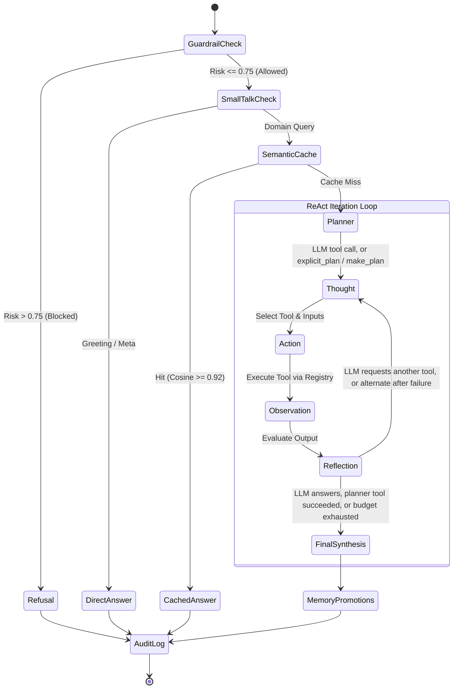

# Agent Architecture & Reasoning Loop

Nexus Engine features an autonomous enterprise agent built on the **ReAct (Reasoning + Acting)** paradigm. Instead of answering complex questions in an unverified single-shot generation, the agent breaks problems down into an auditable, self-healing sequence of discrete reasoning states.

---

## 1. ReAct Reasoning State Graph

The core reasoning engine manages five explicit step types defined in [`StepKind`](../nexus_engine/schemas/agent.py):



### The 5 Trace Steps Explained

| Step | Identifier | Purpose | Emitted Content |
| :--- | :--- | :--- | :--- |
| **#1 Thought** | `thought` | Internal deliberation and planning. Expresses why the agent is choosing a specific strategy or tool. Prefix indicates retry attempts. | `"Plan: factual question about the knowledge base. I will use search_knowledge_graph."` |
| **#2 Action** | `action` | The invocation event. Specifies the targeted tool and the arguments/query passed to it. | `"Calling search_knowledge_graph"` with input `"What are the breach notification obligations?"` |
| **#3 Observation** | `observation` | The raw environment feedback returned by the tool execution (e.g. document excerpts, Python stdout, or web search results). | `"[Document: Global Export Control...] 1. This guideline defines compliance obligations..."` |
| **#4 Reflection** | `reflection` | Self-evaluation of the observation. The agent judges if the observation adequately addresses the plan, or if an alternative fallback tool is required. | `"search_knowledge_graph returned usable output; no further tools needed."` *(or switch to alternate)* |
| **#5 Final** | `final` | The complete, conversational synthesized answer delivered to the user, incorporating context and citations. | `"Hello! Based on the internal documentation..."` |

---

## 2. Execution Lifecycle (`AgentLoop.iter_run`)

The primary orchestration routine is housed in [`nexus_engine.services.agent.loop.AgentLoop`](../nexus_engine/services/agent/loop.py). Each query executes through the following pipeline:

### Step 1: Guardrail Evaluation
Before any planning occurs, the query passes through the dual-process guardrail:
- If `decision == "block"`, the agent immediately emits a `thought` describing the safety route and risk score, followed by a `final` refusal step. No tools or LLMs are invoked.

### Step 2: Small-Talk Short-Circuit
The query is analyzed by `classify_smalltalk(query)`:
- Greetings (`"hello"`), expressions of gratitude (`"thanks"`), and general capability queries (`"help"`, `"what can you do?"`) bypass the tool loop entirely.
- A conversational greeting is emitted directly (via LLM or template) and logged without polluting the semantic cache.

### Step 3: Tier 2 Semantic Cache Lookup
The agent queries the persistent vector semantic cache:
- If a semantically identical query exists ($\text{cosine similarity} \ge 0.92$), the cached answer is returned immediately with `cache_hit: true`.

### Step 4: Tool Routing

Who picks the tool depends on the provider:

| Mode | Who chooses tools | When |
| :--- | :--- | :--- |
| **Native tool calling** | The LLM, via `ToolRegistry.definitions()` passed as tool schemas | Real provider (Gemini, Ollama/vLLM) and the query is not an explicit command |
| **Explicit command** | [`explicit_plan(query)`](../nexus_engine/services/agent/planner.py) | A bare URL (`http_fetch`), `web search: ...` (`web_search`), or code / `calculate ...` (`execute_sandbox_code`) |
| **Deterministic planner** | [`make_plan(query)`](../nexus_engine/services/agent/planner.py) | Mock/offline provider, or the LLM failed before calling any tool |

The model chooses; **code decides what may run**. Only registered tools are offered, unknown tools and calls with a missing argument are refused (the refusal is fed back to the model), and `MAX_AGENT_STEPS` (default 4) is counted by the loop, not the model. Parallel calls past the budget are answered with "step budget exhausted" and never execute.

### Step 5a: Native Tool-Calling Loop (`_llm_tool_loop`)
1. The model receives `SYSTEM_PROMPT`, the compressed session history, the query, and the tool schemas.
2. Every model turn is **streamed** (`stream_turn`): text deltas go to the client as `token` events as they arrive.
3. If the turn ends in tool calls, any text streamed in that turn was preamble: the loop emits `reset`, records the text as the `thought`, then emits `action` / `observation` per call (plus a failure `reflection` when a tool fails).
4. Each tool result is compressed (`compress_observations`) and returned as a `role="tool"` message wrapped in `<tool_output tool=... ok=...>` tags. The system prompt tells the model to treat that content strictly as data; a forged closing tag inside the output is neutralised.
5. The model can chain tools (e.g. search, then compute in the sandbox). Once the budget is spent, the next turn offers no tools, so the model must answer from what it has.
6. If the provider fails mid-run, the loop falls back: to the deterministic planner when no tool had run yet, otherwise to a template answer over the results already gathered. It never retries the dead provider for synthesis.

### Step 5b: Deterministic Dispatch & Self-Healing (`_planned_tools`)
While the plan queue has steps and `attempt < MAX_AGENT_STEPS`:
1. **Emit Thought** (template) and **Action**.
2. **Execute Tool**: `ToolRegistry.call(name, tool_input, session_id)` never raises; exceptions become failed observations.
3. **Self-Healing Fallback**: on failure, `alternate_for(tool, query)` queues an alternate (sandbox to search, search to recall, ...).
4. **Emit Reflection**, and stop at the first usable result.

Recall routing only matches phrasings about the conversation itself ("did I ask", "what did we discuss", "my name"). Bare "before" / "earlier" / "previous" no longer route to `recall_memory`, since they also appear in ordinary questions such as "notice required before exporting".

### Step 6: Context Compression & Synthesis (planner path)
- **Context Compression**: Raw tool observations and conversation history pass through `ContextCompressor.compress()`. Bulky payloads are relevance-pruned down to the token budget.
- **LLM Synthesis**: With a real provider, the compressed prompt is streamed from the LLM; the mock provider uses templates.
- **Observability Spans**: `guardrail_evaluation`, `semantic_cache_check`, `llm_turn`, `tool_*`, `context_compression`, `llm_synthesis` are recorded by `ObservabilityTracer` for Langfuse and the local latency waterfall.

### Step 7: Memory Promotions & Audit Chaining
- Verified facts (supported by both vector ANN and graph traversal) are promoted to Tier 2 cache, but only when every successful tool in the run was `search_knowledge_graph`: answers built on web, sandbox or recall output can go stale and are never cached.
- The entire turn (query, thoughts, actions, observations, answer, citations) is committed to the Tier 3 cryptographic SQLite audit log.

---

## 3. Tool Suite & Registry

All tools are registered in [`nexus_engine/services/agent/tools.py`](../nexus_engine/services/agent/tools.py):

| Tool Name | Service Dependency | Primary Capability |
| :--- | :--- | :--- |
| `search_knowledge_graph` | `HybridRetriever` | Queries embedded SQLite vectors + recursive CTE knowledge graph, fusing results with Reciprocal Rank Fusion ($k=60$). |
| `execute_sandbox_code` | `SandboxExecutor` | Executes Python snippets in an ephemeral, resource-capped OS Job Object subprocess. |
| `recall_memory` | `MemoryManager` | Recalls prior interactions strictly scoped to the active `session_id`. |
| `web_search` | `SafeHTTPClient` | Live DuckDuckGo search passing through zero-trust `SSRFGuard`. |
| `http_fetch` | `SafeHTTPClient` | Fetches and cleans web page content (2MB size cap, SSRF protected). |

---

## 4. Pluggable LLM Providers

The agent decouples reasoning orchestration from specific model vendors using the abstract [`LLMClient`](../nexus_engine/services/agent/providers/base.py) interface:

1. **Google Gemini AI (`GeminiLLMClient`)**:
   - Uses `gemini-3.5-flash-lite`.
   - Supports native structured function calling via Gemini tool declarations.
   - Retains Gemini `thoughtSignature` across multi-turn tool calling conversations.
   - Captures detailed token usage (`prompt_tokens`, `completion_tokens`, `total_tokens`).
2. **OpenAI-Compatible / Local Ollama (`OpenAICompatibleLLMClient`)**:
   - Connects to local servers (e.g. Ollama running `llama3.2`, vLLM, or LM Studio) via `/v1/chat/completions`.
3. **Deterministic Mock (`MockLLMClient` & `MockLLM`)**:
   - Driven by built-in fallback templates in `nexus_engine.core.data_loader`.
   - Guarantees 100% offline determinism for test suites and air-gapped environments.

---

## 5. Real-Time Streaming Protocol (SSE)

When interacting via `/api/v1/agent/stream`, the agent pushes events over HTTP Server-Sent Events in real-time:

```
event: step
data: {"index": 0, "kind": "thought", "content": "Model chose search_knowledge_graph (query='breach notification').", ...}

event: step
data: {"index": 1, "kind": "action", "content": "Calling search_knowledge_graph", ...}

event: step
data: {"index": 2, "kind": "observation", "content": "[Data Processing Agreement > Chapter II > Article 4 > Clause 1] ...", ...}

event: token
data: {"text": "According to the knowledge base, "}

event: token
data: {"text": "the processor must notify ..."}

event: step
data: {"index": 3, "kind": "final", "content": "According to the knowledge base, ...", ...}

event: done
data: { ...full AgentRunResponse payload... }
```

| Event | Meaning |
| :--- | :--- |
| `step` | One trace step (`thought`, `action`, `observation`, `reflection`, `final`). |
| `token` | A text delta. With a real provider these are the model's live stream; for mock, cache-hit and blocked runs the finished answer is replayed word by word just before `done`. |
| `reset` | Discard the tokens received so far: they were preamble to a tool call, or the LLM failed and a fallback answer follows. |
| `done` | The full `AgentRunResponse`; its `answer` is authoritative. |
| `error` | `{"detail": "..."}` when the run raised. |

In full-stack integrations (such as the `nexus-sample` frontend UI), client components subscribe to these events to render the collapsible reasoning trace dynamically as each step completes.

---

## 6. Source Code Directory Map

| Concept | Source File | Description |
| :--- | :--- | :--- |
| **ReAct Loop Engine** | [`nexus_engine.services.agent.loop.AgentLoop`](../nexus_engine/services/agent/loop.py) | `AgentLoop` state machine, step emission, and tool dispatching. |
| **Context Compressor** | [`nexus_engine/services/agent/compressor.py`](../nexus_engine/services/agent/compressor.py) | 120k -> 8k extractive pruner and dialogue summarizer. |
| **Token Budget Manager** | [`nexus_engine/services/agent/budget.py`](../nexus_engine/services/agent/budget.py) | Quota verification, pricing table, and cost savings accounting. |
| **Observability Tracer** | [`nexus_engine/services/observability/tracer.py`](../nexus_engine/services/observability/tracer.py) | Langfuse tracing adapter and local latency waterfall telemetry. |
| **Planner & Heuristics** | [`nexus_engine/services/agent/planner.py`](../nexus_engine/services/agent/planner.py) | Small-talk classification, explicit-command shortcuts, offline routing, and fallback rules. |
| **Async Bridge** | [`nexus_engine/core/async_bridge.py`](../nexus_engine/core/async_bridge.py) | One long-lived event loop for sync-to-async calls, so pooled HTTP clients survive between requests. |
| **Tools & Registry** | [`nexus_engine/services/agent/tools.py`](../nexus_engine/services/agent/tools.py) | Tool implementations and JSON schema specifications. |
| **LLM Provider Interface** | [`nexus_engine/services/agent/providers/base.py`](../nexus_engine/services/agent/providers/base.py) | Abstract provider protocol and message models. |
| **Gemini Integration** | [`nexus_engine/services/agent/providers/gemini.py`](../nexus_engine/services/agent/providers/gemini.py) | Google Gemini 3.5 Flash Lite client with tool calling. |
| **Local Models (Ollama)** | [`nexus_engine/services/agent/providers/openai_compatible.py`](../nexus_engine/services/agent/providers/openai_compatible.py) | Local OpenAI-compatible API adapter. |
| **Mock Templates** | `nexus_engine.core.data_loader` | Built-in fallback template definitions for offline deterministic traces. |
| **Data Schemas** | [`nexus_engine/schemas/agent.py`](../nexus_engine/schemas/agent.py) | Pydantic definitions for `Step`, `StepKind`, and `AgentRunResponse`. |
| **API Endpoints** | [`nexus_engine/api/v1/agent.py`](../nexus_engine/api/v1/agent.py) | FastAPI `/run` and `/stream` route handlers. |
