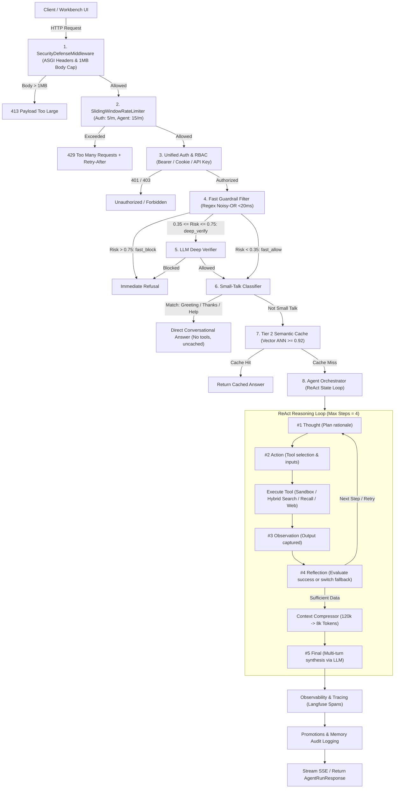

# Architecture Overview

Nexus Engine is a production-grade enterprise agent platform featuring real LLM reasoning, an embedded hybrid vector and graph database, multi-tier memory with cryptographic audit chaining, an OS execution sandbox, a zero-trust network egress subsystem with SSRF protection, an API defense perimeter with rate limiting, and an automated evaluation suite.

---

## High-Level Request Pipeline



---

## Core System Modules

### 1. Dual-Process Guardrail (`nexus_engine/services/guardrail/`)
- **Fast Filter (`fast_filter.py`)**: Sub-millisecond precompiled regex matching with noisy-OR probabilistic risk scoring ($<20\text{ ms}$). Handles prompt injection, jailbreak keywords, and system exfiltration attempts.
- **Deep Verifier (`deep_verifier.py`)**: LLM-powered safety evaluation for ambiguous queries in the borderline risk range $[0.35, 0.75]$.
- **Router (`router.py`)**: Unified `Guardrail.evaluate()` coordinating fast-allow, deep-verify, and fast-block decisions.
- *Detailed policy thresholds and OWASP cross-references available in [compliance_and_security_matrix.md](compliance_and_security_matrix.md).*

### 2. Agent Orchestration Engine (`nexus_engine/services/agent/`)
- **State Loop (`loop.py`)**: Implements the ReAct iteration protocol: `thought` $\to$ `action` $\to$ `observation` $\to$ `reflection` $\to$ `final`. Coordinates tool execution, error recovery, streaming token resets, and SSE event streaming.
- **Planner (`planner.py`)**: Heuristic and rule-based query classifier generating `PlanStep` sequences and alternative tool fallbacks (e.g. `execute_sandbox_code` $\to$ `search_knowledge_graph` $\to$ `recall_memory`).
- **Pluggable LLM Providers (`providers/`)**:
  - `GeminiLLMClient`: Native Google Gemini API (`gemini-3.5-flash-lite`) supporting structured function calling, `thoughtSignature` preservation, and token usage accounting.
  - `OpenAICompatibleLLMClient`: Local models via Ollama or vLLM (`/v1/chat/completions`).
  - `MockLLMClient`: Fully offline, deterministic template-driven mock for continuous integration and unit testing.
- *Detailed specification available in [agent.md](agent.md).*

### 3. Extensible Tool Suite (`nexus_engine/services/agent/tools.py`)
1. `search_knowledge_graph`: Hybrid vector cosine ANN + recursive graph traversal fused via Reciprocal Rank Fusion (RRF, $k=60$).
2. `execute_sandbox_code`: Subprocess execution within resource-bounded OS Job Objects / limits.
3. `recall_memory`: Session-scoped episodic memory lookup across prior conversation turns.
4. `web_search`: Live outbound web search (via DuckDuckGo) guarded by SSRF network filtering.
5. `http_fetch`: Safe web page text extractor with a 2MB payload cap and SSRF domain/IP validation.

### 4. Storage Subsystem & Hybrid Retrieval (`nexus_engine/services/storage/` & `retrieval/`)
- **Embedded Database (`nexus.db`)**: Single-file SQLite database hosting:
  - Vector chunks with normalized dense vector embeddings (Google `text-embedding-004` or remote ONNX `multilingual-e5-base`).
  - Hierarchical and relational knowledge graph (Document $\to$ Chapter $\to$ Article $\to$ Clause) with SQL Recursive Common Table Expressions (CTE) for deep relation traversal.
  - Persistent Tier 2 Semantic Cache.
- **Hierarchical Document Ingestion (`nexus_engine/services/ingestion/`)**: Parsers for structured legal codes (Commercial Contract Standards), Markdown corporate SOPs, bilingual compliance documents, and automated entity-relation extraction.

### 5. Multi-Tier Memory Subsystem (`nexus_engine/services/memory/`)
1. **Tier 1 — Short-Term Memory (`short_term.py`)**:
   - In-memory per-session sliding window of $K$ turns (default 8) with token truncation.
   - Session lifecycle managed with maximum session capacity (`MAX_SESSIONS`) and idle TTL expiration (`SESSION_TTL_S`).
2. **Tier 2 — Semantic Cache (`semantic_cache.py`)**:
   - Disk-backed vector cache using cosine similarity (threshold 0.92).
   - Instant response without invoking LLM or tool execution; LRU-eviction policy.
3. **Tier 3 — Persistent Audit Ledger (`persistent_audit.py`)**:
   - SQLite append-only log with SHA-256 cryptographic hash-chaining (`prev_hash` $\to$ `row_hash`).
   - SQLite triggers prevent `UPDATE` or `DELETE` operations.
   - Verifiable via `GET /api/v1/memory/audit/verify`.

#### Memory Promotions:
- `short_to_audit`: Expired or evicted short-term turns are recorded to the persistent audit ledger.
- `verified_to_cache`: Answers validated by high-confidence retrieval (passages independently verified by both dense vector and graph traversal) are promoted directly to Tier 2 cache.
- `audit_to_cache`: Answers recorded in audit precedent $\ge 3$ times are automatically elevated to Tier 2 cache.

### 6. Controlled Network Subsystem & SSRF Guard (`nexus_engine/services/network/`)
- Zero-trust outbound network client (`SafeHTTPClient`).
- Pre-flight DNS resolution checking against loopback (`127.0.0.0/8`, `::1`), private RFC 1918 subnets (`10.0.0.0/8`, `172.16.0.0/12`, `192.168.0.0/16`), link-local (`169.254.0.0/16`), and cloud metadata IP addresses (`169.254.169.254`, `metadata.google.internal`).
- Connection pinning: connections are pinned to vetted target IPs across redirect chains, bounded by a strict hop cap.

### 7. Hardened OS Execution Sandbox (`nexus_engine/services/sandbox/`)
- Ephemeral subprocess execution in isolated temporary directories.
- Resource constraints enforced via Windows Job Objects (commit memory limits, CPU wall-clock timeouts, child process count = 1) and POSIX limits.
- In-process audit hooks rejecting unauthorized socket operations.
- *Detailed specification available in [sandbox.md](sandbox.md).*

### 8. Observability & Token Efficiency Architecture (`nexus_engine/services/observability/` & `agent/`)
- **Context Compressor & Pruner (`compressor.py`)**: Condenses up to 120,000+ raw input tokens down to $\le 8,192$ tokens via keyword-density paragraph scoring, whitespace deduplication, and dialogue turn summarization.
- **Token Budget Manager (`budget.py`)**: Thread-safe quota tracking, inference cost estimation (`gemini-3.5-flash-lite`), and cumulative financial savings calculations.
- **Langfuse Observability Tracer (`tracer.py`)**: Framework-agnostic, non-blocking tracing layer supporting both Langfuse Cloud and On-Premise air-gapped instances with granular span waterfalls.
- *Detailed specification available in [observability.md](observability.md).*

### 9. API Defense & Perimeter Security (`nexus_engine/services/security/`)
- **Input Validator & Security Middleware (`middleware.py`, `validator.py`)**: Pure ASGI `SecurityDefenseMiddleware` enforcing payload caps (1 MB JSON, 10 MB file uploads $\to$ HTTP 413), HTTP security headers (`X-Content-Type-Options: nosniff`, `X-Frame-Options: DENY`, `Strict-Transport-Security`, `Content-Security-Policy`, `Referrer-Policy`), identifier validation against path traversals, upload filename sanitization, and JSON nesting recursion depth limits ($\le 20 \to \text{HTTP 422}$).
- **Rate Limiter & Burst Protection (`rate_limiter.py`)**: Thread-safe in-memory `SlidingWindowRateLimiter` managing endpoint tiers (`auth`: 5/min, `agent`: 15/min, `ingestion`: 10/min, `general`: 120/min), emitting `X-RateLimit-*` headers and HTTP 429 with `Retry-After`.
- **Authentication & RBAC (`auth_manager.py`)**: Salted PBKDF2-HMAC-SHA256 (`100,000` iterations) password hashing, 256-bit URL-safe session tokens with 24h absolute TTL and 2h idle timeout, timing-safe unknown user mitigation, unified `get_current_user` dependency (Bearer tokens, cookies, `X-API-Key`, or local open dev fallback), and granular role-based access control (`admin`, `operator`, `auditor`).

### 10. Automated Evaluation Architecture & Benchmark Decoupling
- **Evaluation Design**: The platform implements formal evaluation metrics for Tool Selection Accuracy, Argument Schema Validity, MRR@3, Graph Completeness, and SSRF/Sandbox attack containment.
- **Decoupled Benchmark Rig (`nexus-engine-sample`)**: To ensure production safety and keep proprietary penetration vectors, golden red-teaming datasets, and corporate evaluation cases confidential, the full 125 benchmark vectors and CLI evaluation runner reside in the [Nexus Engine Sample](https://github.com/your-org/nexus-engine-sample) companion repository (`backend/evals/`).
- *Detailed metrics and evaluation methodology available in [evaluation.md](evaluation.md).*

### 11. Decoupled UI & Reference Application
- While the core SDK is fully headless (exporting both Python APIs and a FastAPI application via `nexus_engine.main:create_app`), interactive visual exploration is supported through:
  - **Reference UI (`nexus-engine-sample/frontend`)**: React 19, TypeScript, and Vite workbench featuring Knowledge Explorer, Agent Scratchpad (SSE real-time streaming), Execution Trace Audit Ledger, and Telemetry HUD.
  - **Vertical Solutions**: Custom user experiences such as [Bank Credit Guard](https://github.com/your-org/bank-credit-guard) credit underwriting workbench.


---

## 12. Platform SDK & Vertical Domain Solutions (`nexus_engine` Reusability Pattern)

Nexus Engine is packaged as a standalone, domain-agnostic enterprise library (`nexus_engine`), allowing organizations to build vertical AI solutions rapidly without reinventing the agentic infrastructure.

### Reusable Platform vs. Domain Solution Topology

```
+===================================================================================================+
|                                    NEXUS-KERNEL (CORE PLATFORM)                                   |
|                          Installable Python Package: `nexus-kernel` (SDK)                         |
+===================================================================================================+
  ├── core/            Container, Dependency Injection, Config, Embeddings, SQLite Engine
  ├── schemas/         Agent, Ingestion, Memory, Retrieval, and Telemetry Pydantic models
  ├── services/
  │   ├── agent/       ReAct Loop, Thought Signature, Tool Registry, Context Compressor, Providers
  │   ├── guardrail/   Dual-Process Engine: Fast Regex (Noisy-OR) + LLM Deep Verifier Framework
  │   ├── ingestion/   Hierarchical Document Chunkers, Extensible Parsers, Graph Builders
  │   ├── retrieval/   Hybrid RRF: Dense Vector ANN + SQL Recursive CTE Knowledge Graph Store
  │   ├── memory/      Episodic Session Memory, Semantic Cache, Tamper-Evident SHA-256 Audit Ledger
  │   ├── sandbox/     Process Quota Sandbox Executor, Memory Caps, Static Analysis Gate
  │   ├── network/     Controlled Outbound HTTP Client, SSRF Guard, DNS IP Pinning
  │   ├── observability/ Langfuse Tracing Adapter, Token Budget Manager, Latency Telemetry
  │   └── security/    ASGI Security Middleware, Rate Limiter, PBKDF2 Session Auth & RBAC
  └── api/             FastAPI REST & SSE Endpoints (`/api/v1/*`), OpenAPI Schema Factory
                                                    ▲
                                                    │  (pip install nexus-kernel / imported as SDK)
                                                    │
+===================================================================================================+
|                                BANK-CREDIT-GUARD (DOMAIN SOLUTION)                                |
|                        Institutional Banking AI Copilot (ApexBank / GPBank)                       |
+===================================================================================================+
  ├── backend/
  │   ├── config/      Banking Environment Settings, Database Paths, Port 8765 / 5199
  │   ├── container.py `BankingContainer(nexus_engine.Container)` (Overrides with Banking Providers)
  │   ├── ingestion/   Legal JSON Parser (Circular 39/06), Underwriting Markdown Parser (QC-TD-CN-2024)
  │   ├── guardrail/   Decree 13 PII Rules, CCCD Regex, Banking Privilege Jailbreak Definitions
  │   ├── agent/       Banking System Prompts, Structured Compliance Memo Provider (Maker-Checker)
  │   ├── evals/       50 Golden QA Cases, 30 Red-Teaming Attacks, 40 Legal Retrieval Benchmarks
  │   └── tests/       217 Banking Compliance & Regression Test Suite
  └── frontend/        React 19 FinTech Workbench (Compliance Scratchpad, Policy Graph, Telemetry HUD)
```

### Implementing a New Domain in < 48 Hours
To build a new domain copilot (e.g. `medical-diagnostics-copilot` or `bank-credit-guard`), developers:
1. **Import `nexus_engine`**: Use the core ReAct loop, Dual-Process Guardrail, Hybrid RRF vector-graph retrieval, and SHA-256 audit ledger.
2. **Provide Domain Schema & Data**: Ingest domain documents through `nexus_engine.services.ingestion.IngestionPipeline`.
3. **Configure Guardrail Rules**: Define domain safety rules (e.g., PII masking, statutory prohibitions).
4. **Plug Domain Prompts**: Configure system prompts with domain directives and custom tool extensions.
Over 85% of agentic plumbing is reused directly from `nexus-kernel`.

*For a detailed implementation guide, see the [Domain Adaptation Blueprint](domain_adaptation_blueprint.md).*
