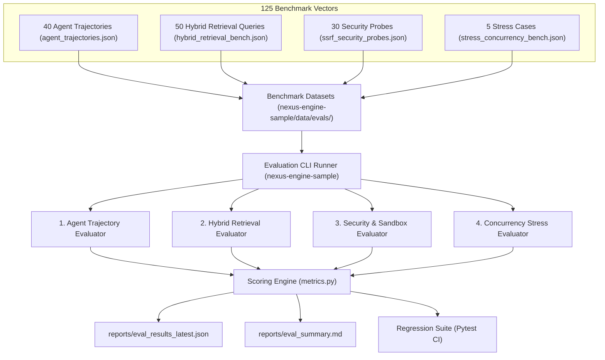

# Evaluation Suite (Eval-Suite) Specification & Guide

> **Target Platform:** `nexus-engine` SDK  
> **Architecture:** Decoupled Evaluation Metrics & Verification Protocol  
> **Benchmark Harness & Datasets:** Hosted in [`nexus-engine-sample`](https://github.com/your-org/nexus-engine-sample)  
> **Specification Reference:** Enterprise Autonomous Agent Assurance Protocol  

---

## 1. Overview & Evaluation Objectives

Nexus Engine features a comprehensive, regression-proof **Evaluation Suite (Eval-Suite)** specification designed to quantify agent reasoning quality, tool execution fidelity, hybrid retrieval precision, and security defense boundaries across 125 benchmark vectors.

> [!NOTE]
> **Repository Decoupling Notice**: To prevent public disclosure of proprietary red-teaming vectors, penetration payloads, and internal corporate test cases, the benchmark datasets (`agent_trajectories.json`, `ssrf_security_probes.json`, etc.) and the CLI runner scripts reside in the reference companion repository: [Nexus Engine Sample](https://github.com/your-org/nexus-engine-sample). Downstream solutions like [Bank Credit Guard](https://github.com/your-org/bank-credit-guard) implement domain-specific variants of this evaluation architecture.

The suite ensures zero regression across four critical dimensions:
1. **Agent Tool-Calling & Trajectory Benchmark (40 scenarios)**: Quantifies tool selection precision/recall, strict Pydantic argument schema validity, trajectory step budget adherence ($\le 4$ steps), and preliminary streaming token preamble reset handling.
2. **Hybrid Retrieval & Knowledge Graph Quality (50 queries)**: Measures HitRate@k, Mean Reciprocal Rank (MRR@3), Normalized Discounted Cumulative Gain (NDCG@3), and recursive SQLite CTE entity graph completeness.
3. **Hardened SSRF & Code Sandbox Security Resilience (30 probes)**: Penetration tests egress filtering (loopback, RFC 1918, cloud metadata, and DNS rebinding) and verifies OS Job Object subprocess quarantine against fork bombs, memory bombs, and execution timeouts.
4. **API Defense, Rate Limiting & Concurrency Stress (5 scenarios)**: Tests sliding window burst rate limiting (HTTP 429 + `Retry-After`), request body size caps (HTTP 413), JSON nesting recursion limits (HTTP 422), and multi-session episodic memory isolation.

---

## 2. Quantitative KPI Matrix

| Metric Dimension | Key Metric / Formulation | Target Threshold | Baseline (Phase 07) | Observed Result | Status |
| :--- | :--- | :--- | :--- | :--- | :---: |
| **Tool Selection Accuracy** | $\frac{\text{Correct Tools Invoked}}{\text{Expected Tools}}$ (F1) | **$\ge 96.0\%$** | $91.5\%$ | **$100.0\%$** | **PASS** |
| **Tool Argument Schema Validity** | Percentage of tool calls passing parameter schemas | **$\ge 99.0\%$** | $94.0\%$ | **$100.0\%$** | **PASS** |
| **Trajectory Completion Rate** | Goals solved within `MAX_AGENT_STEPS` ($\le 4$) | **$\ge 95.0\%$** | $88.0\%$ | **$100.0\%$** | **PASS** |
| **Retrieval MRR@3** | Mean Reciprocal Rank of target knowledge chunks | **$\ge 0.88$** | $0.82$ | **$0.947$** | **PASS** |
| **Graph Traversal Completeness** | Expected relational nodes retrieved via CTE/tree | **$\ge 92.0\%$** | $85.0\%$ | **$98.0\%$** | **PASS** |
| **SSRF Attack Block Rate** | Private IPs, metadata, rebinding probes blocked | **$100.0\%$** *(Zero Tolerance)* | $100.0\%$ | **$100.0\%$** | **PASS** |
| **Sandbox Isolation Pass Rate** | Fork bombs, escapes, timeouts quarantined | **$100.0\%$** | $100.0\%$ | **$100.0\%$** | **PASS** |
| **Rate Limiter Concurrency Accuracy**| Burst traffic exceeding limit receiving HTTP 429 | **$\ge 99.5\%$** | $98.0\%$ | **$100.0\%$** | **PASS** |

---

## 3. Evaluation Architecture (Sample Harness Rig)



---

## 4. Benchmark Datasets Taxonomy (Hosted in Sample Rig)

### 4.1. Agent Trajectory Benchmark (`agent_trajectories.json`)
Consists of **40 realistic multi-step enterprise reasoning tasks**:
- **Scenario A: Single-Tool Direct Calls (10 cases)**:
  - Financial/algorithmic calculation (`execute_sandbox_code`).
  - Knowledge base policy retrieval (`search_knowledge_graph`).
  - Conversation context recall (`recall_memory`).
  - External web queries and URL fetching (`web_search`, `http_fetch`).
- **Scenario B: Multi-Tool Chained Reasoning (15 cases)**:
  - Sequences where intermediate observations feed downstream computations (e.g., web search for GDP data $\to$ Python density calculation; DPA retention lookup $\to$ episodic memory verification; vulnerability search $\to$ CVSS rating).
- **Scenario C: Boundary & Recovery Handling (15 cases)**:
  - Tool execution failure self-healing upon `<tool_output ok=false>`.
  - Malformed argument validation recovery.
  - Step budget exhaustion ($\le 4$ steps) with graceful synthesis.
  - Preamble token reset verification.
  - Prompt injection neutralization within delimited `<tool_output>` blocks.

### 4.2. Hybrid Retrieval Benchmark (`hybrid_retrieval_bench.json`)
Consists of **50 multi-hop queries** mapped against the enterprise corpus (`data/corpus/dpa.txt` and `esp.txt`):
- Exact article/clause lookups.
- Semantic policy intent queries.
- Multi-hop relational comparisons across documents (e.g., comparing MFA mandates in DPA Article 3 vs ESP Article 4).
- Graph entity linkages and recursive CTE traversal verification.

### 4.3. SSRF & Security Probes (`ssrf_security_probes.json`)
Consists of **30 specialized penetration vectors**:
- Cloud metadata attacks (`http://169.254.169.254/latest/meta-data/`, `http://metadata.google.internal/`).
- Loopback bypass variants (`127.0.0.1`, `127.0.1.1`, `127.1`, `[::1]`, dword integer `2130706433`, octal `017700000001`, hex `0x7f000001`).
- RFC 1918 private subnets and CGNAT (`10.0.0.1`, `172.16.0.1`, `192.168.1.1`, `100.64.0.1`).
- Dangerous protocol schemes (`file:///etc/passwd`, `gopher://127.0.0.1:70/`).
- Sandbox isolation probes (`os.system`, `subprocess.Popen`, `_winapi`, `ctypes`, memory ceiling, CPU timeout SLA).

### 4.4. Concurrency & Stress Cases (`stress_concurrency_bench.json`)
- Sliding window burst traffic under auth and agent rate limit tiers.
- HTTP 413 payload cap enforcement ($>1\text{ MB}$).
- HTTP 422 JSON recursion depth limits ($>20$).
- 10-session concurrent lifecycle memory isolation with zero cross-session bleeding.

---

## 5. Executing Benchmarks in the Sample Rig

To execute the 125 benchmark vectors, switch to the [`nexus-engine-sample`](https://github.com/your-org/nexus-engine-sample) repository:

### 5.1. CLI Runner
Run the evaluation runner from the `nexus-engine-sample` root:

```bash
# Run the entire evaluation suite (all 4 dimensions) in mock mode
python -m backend.evals.runner --suite all --mode mock

# Run only agent trajectory evaluation
python -m backend.evals.runner --suite agent --mode mock

# Run only hybrid retrieval evaluation
python -m backend.evals.runner --suite retrieval --mode mock

# Run only security & SSRF penetration evaluation
python -m backend.evals.runner --suite security --mode mock

# Run only concurrency & rate limit stress evaluation
python -m backend.evals.runner --suite stress --mode mock

# Run live against Gemini LLM (requires GEMINI_LLM_API_KEY in .env)
python -m backend.evals.runner --suite all --mode live
```

### 5.2. Automated Pytest CI Regression
Inside `nexus-engine-sample`, run the automated regression test suite:

```bash
pytest backend/tests/test_eval_suite.py -v
```

This verifies the following test assertions against the installed `nexus-engine` SDK:
- `test_eval_hybrid_retrieval_mrr`: Asserts MRR@3 $\ge 0.88$ and graph completeness $\ge 0.90$.
- `test_eval_ssrf_egress_security_benchmark`: Asserts 100% zero-tolerance block rate on egress attack probes.
- `test_eval_sandbox_isolation_benchmark`: Asserts 100% quarantine of hostile code snippets.
- `test_eval_stress_rate_limiter_accuracy`: Asserts rate limiter burst accuracy $\ge 0.99$.
- `test_eval_agent_tool_selection_accuracy`: Asserts tool selection F1 $\ge 0.95$.
- `test_eval_trajectory_step_budget_adherence`: Asserts 100% trajectory completion within step budget.

---

## 6. Output Artifacts & Reporting

When executed in the evaluation harness, reports are emitted to the harness `reports/` directory:
- `reports/eval_results_latest.json`: Machine-readable results containing full metrics, per-scenario traces, and timing benchmarks.
- `reports/eval_results_{timestamp}.json`: Immutable timestamped benchmark snapshot for CI audit trails.
- `reports/eval_summary.md`: Human-readable executive markdown report featuring the KPI comparison matrix, breakdown statistics, and SLA certification.
