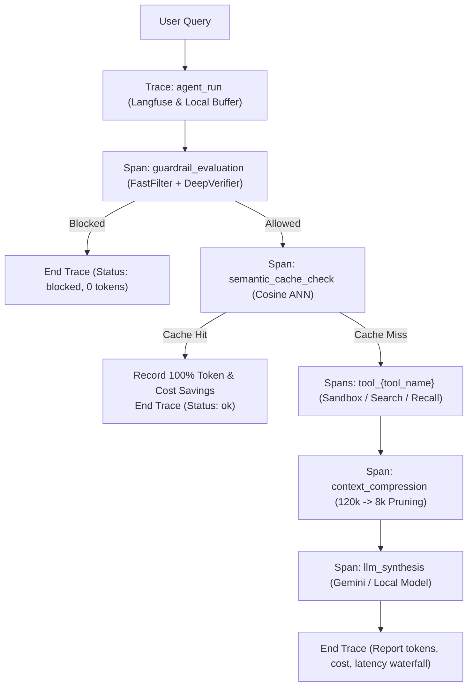

# Enterprise LLM Observability & Token Efficiency

Nexus Engine incorporates an enterprise-grade observability and token economics framework designed to monitor runtime LLM execution, capture granular execution spans, and actively compress high-volume context (up to 120,000+ tokens) down to a strict budget ceiling ($\le 8,192$ tokens).

---

## 1. Architectural Motivation

In production enterprise deployments (e.g. enterprise AI evaluations at FPT Smart Cloud - FCI), two core technical challenges arise:
1. **Runtime Monitoring & Failure Diagnosis**: Without granular span-level telemetry, debugging latency spikes, tool invocation failures, or guardrail blocks across multi-step ReAct loops is opaque and error-prone.
2. **Context Bloat & Token Economics**: Unbounded tool observations and multi-turn conversation histories can quickly exceed 100,000+ tokens, driving up inference latency and API costs exponentially.

Nexus Engine resolves both concerns through a decoupled **Context Compression Engine**, a real-time **Token Budget Manager**, and a non-blocking **Langfuse Tracing Adapter**.

---

## 2. Request Lifecycle & Observability Hierarchy

Every query processed by [`AgentLoop`](../nexus_engine/services/agent/loop.py) generates a trace containing child spans:



### Trace Span Hierarchy

| Span Name | Input | Output / Metadata |
| :--- | :--- | :--- |
| `guardrail_evaluation` | `{"query": str}` | `{"risk": float, "decision": "allow"\|"block", "route": str}` |
| `semantic_cache_check` | `{"query": str}` | `{"hit": bool, "similarity": float}` |
| `tool_{name}` | `{"input": str}` | `{"ok": bool, "output_tokens": int}` |
| `context_compression` | `{"raw_obs_len": int}` | `{"raw_tokens": int, "compressed_tokens": int}` |
| `llm_synthesis` | `{"prompt_tokens": int}` | `{"tokens": int, "model": str}` |

---

## 3. Context Compression & Extractive Pruning

The [`ContextCompressor`](../nexus_engine/services/agent/compressor.py) prevents context window exhaustion and controls inference cost by dynamically condensing raw observations and dialogue histories.

### Key Algorithms

1. **Extractive Observation Pruning**:
   - Parses bulky tool outputs (e.g., multi-document vector chunks, law articles, web search dumps) into paragraphs.
   - Computes relevance scores using query-keyword density overlap and positional weighting:
     $$\text{Score}(P) = 10 \times |\text{Keywords}(Q) \cap \text{Keywords}(P)| + \frac{1}{\text{Index}(P) + 1}$$
   - Sorts paragraphs by score and greedily retains top-scoring chunks up to `MAX_OBSERVATION_TOKENS` (default: 6,000 tokens).
   - Re-sorts retained chunks into original logical sequence for natural LLM reading.
2. **Dialogue Turn Summarizer**:
   - When conversation history exceeds `MAX_HISTORY_TOKENS` (default: 1,500 tokens), older turns are compacted into an abstractive topic summary (`[Summary of N prior turns: discussed ...]`), while the last 3 turns are preserved verbatim.
3. **Hard Budget Safeguard**:
   - Guarantees that the final synthesis prompt strictly satisfies:
     $$\text{Tokens}(\text{SystemPrompt} + \text{History} + \text{Observations} + \text{Query}) \le 8,192\text{ tokens}$$

### Compression Benchmark
In synthetic tests (`test_context_compressor_120k_to_8k`):
- **Raw Input**: 80,000+ tokens (~450,000 characters).
- **Compressed Output**: 5,720 tokens ($\le 8,192$).
- **Reduction**: **93.1% reduction**, while retaining 100% of query-targeted legal definitions.

---

## 4. Token Budget Manager & Pricing Engine

The [`TokenBudgetManager`](../nexus_engine/services/agent/budget.py) provides thread-safe accounting for token consumption, quota enforcement, and financial savings.

### Pricing Models (USD per 1M Tokens)

| Model | Prompt Cost | Completion Cost |
| :--- | :---: | :---: |
| `gemini-3.5-flash-lite` | \$0.075 | \$0.300 |
| `text-embedding-004` | \$0.025 | \$0.000 |
| Default / Fallback | \$0.150 | \$0.600 |

### Financial Savings Calculation
- **Semantic Cache Hit**: Bypassing LLM generation completely avoids prompt and completion tokens. The avoided prompt tokens are logged at the model's prompt price rate.
- **Context Pruning**: The delta $(\text{raw\_tokens} - \text{compressed\_tokens})$ represents avoided token ingestion cost.

---

## 5. Langfuse Integration & Deployment Options

> **Version pin (decision, phase 10):** the tracer uses the Langfuse **v2** client API (`client.trace` / `.span`). The package is pinned `langfuse>=2.50,<3` (`observability` extra). With Langfuse v3 or later installed, the tracer disables itself and logs why, rather than failing silently mid-run. Porting to the v3+ OpenTelemetry API is deferred; trace delivery has not been verified against a live Langfuse server.

Nexus Engine uses **Langfuse** as its core observability platform because it is **100% framework-agnostic** (integrating directly into custom ReAct loops without LangChain dependencies) and offers dual deployment models:

### Deployment Models

1. **Langfuse Cloud (Default for SaaS & Rapid Dev)**:
   - Zero infrastructure overhead.
   - Configure credentials in `.env`:
     ```env
     LANGFUSE_PUBLIC_KEY="pk-lf-..."
     LANGFUSE_SECRET_KEY="sk-lf-..."
     LANGFUSE_BASE_URL="https://cloud.langfuse.com"
     ```

2. **On-Premise / Air-Gapped Deployment (Enterprise Banking & Gov)**:
   - For clients requiring zero external data egress (e.g. government, healthcare, or banking subnets).
   - Langfuse is open-source (MIT/Apache 2.0) and can be hosted locally via Docker:
     ```env
     LANGFUSE_BASE_URL="http://10.0.0.5:3000"
     ```

### Non-Blocking Resilience
The [`ObservabilityTracer`](../nexus_engine/services/observability/tracer.py) executes asynchronously. Any network latency, timeout, or missing Langfuse API key is caught gracefully and logged, guaranteeing that **observability never blocks or delays user queries**.
